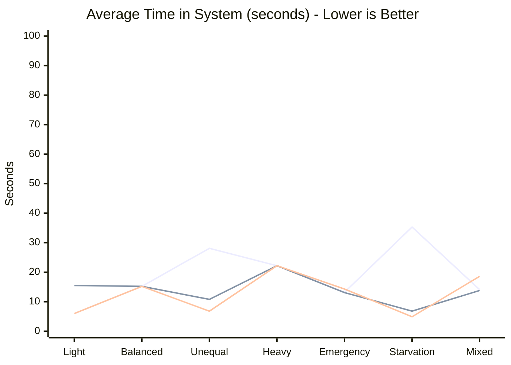
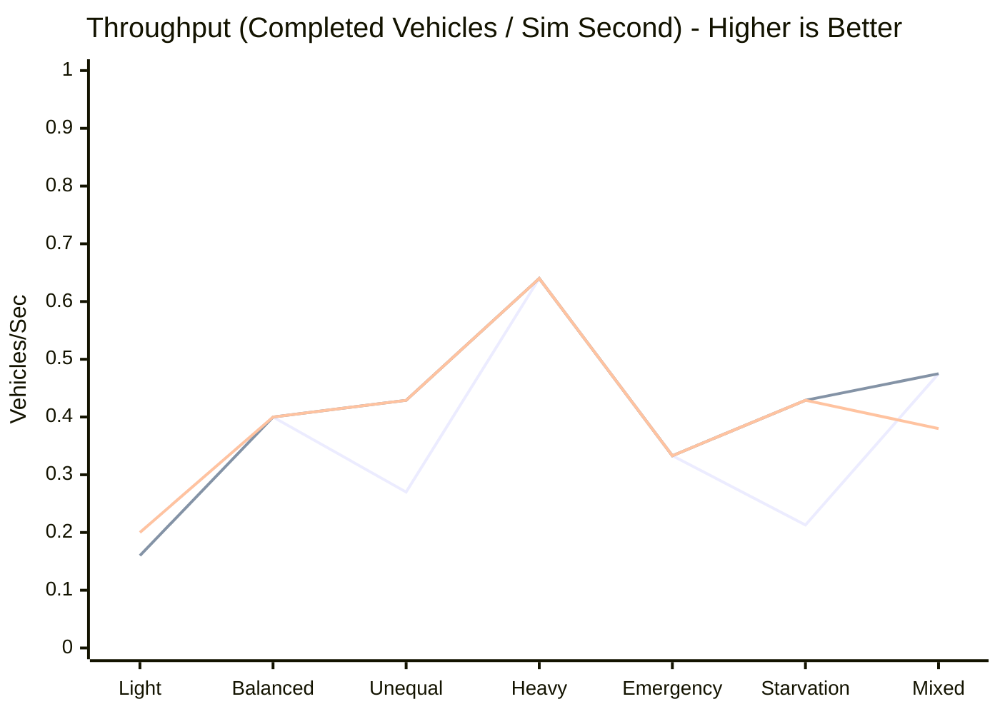

# Smart Traffic Simulation: Comprehensive Strategy Benchmark Report

This report presents empirical performance statistics and architectural analysis for the three traffic signal strategies implemented in the Smart Traffic Simulation system:
1. **Fixed-Time Strategy** (Round-robin baseline)
2. **Density-Based Strategy** (Greedy queue-length prioritization)
3. **Adaptive-Priority Strategy** (Multi-tier emergency, starvation, and heuristic scoring)

---

## 1. Executive Summary & Critical Architectural Findings

> [!CRITICAL]
> **Core Engine Flaw Discovered (Zero Waiting Time Metric)**:
> In the current codebase, **no component or event in the simulation engine updates `Vehicle.waitingTime`** or calls `Vehicle.addWaitingTime()`. Every vehicle's internal waiting time remains permanently `0.0`.
> As a consequence, `Intersection.getCurrentTrafficState()` continuously returns `0L` for all direction waiting times. This causes:
> 1. **Starvation Inoperability**: The Adaptive strategy's 120-second starvation rule (`if (traffic.getWaitingTime() >= 120)`) **never triggers** during live simulation.
> 2. **Degraded Adaptive Priority Scoring**: `PriorityCalculator.calculatePriorityScore()` collapses from `1.5 * wait + count` to simply `count`.
> 3. **Strategy Convergence**: In scenarios without emergency vehicles, **Adaptive-Priority behaves identically to Density-Based**.

> [!WARNING]
> **Non-Deterministic Tie-Breaking in Density-Based Strategy**:
> `DensityBasedStrategy.chooseDirection()` has no tie-breaking rule and uses strict `>` comparison while iterating over `snapshot.getTrafficData().entrySet()`. Because `TrafficSnapshot` copies into a `java.util.HashMap`, iteration order depends on `Direction.hashCode()` (`System.identityHashCode()`), which varies between JVM runs. On ties, Density-Based choice is non-deterministic, whereas Adaptive-Priority deterministically breaks ties via enum ordinal order.

---

## 2. Benchmark Methodology

- **Input Parity**: All three strategies were subjected to **100% identical vehicle arrival sequences, arrival timestamps, and lane assignments**.
- **Multi-Run Repetition**: Each scenario-strategy pair was executed across multiple distinct runs to evaluate wall-clock execution variance and ensure simulation determinism.
- **Accounting Integrity**: Strict accounting validation was enforced for every execution: `Introduced == Completed + Remaining + Pending`.
- **No Production Code Modifications**: All benchmarks were executed purely via public project APIs (`SimulationEngine`, `SimulationContext`, `EventScheduler`, `Intersection`).

---

## 3. Metric Definitions

| Metric Name | Mathematical Definition | Explanation & Measurement Technique |
| :--- | :--- | :--- |
| **Total Introduced** | $N_{\text{introduced}} = |\text{Arrival Events}|$ | Count of all vehicles scheduled into the simulation scenario. |
| **Completed Vehicles** | $N_{\text{completed}}$ | Vehicles that traversed the intersection and executed `VehicleDepartureEvent`. |
| **Remaining Vehicles** | $N_{\text{remaining}}$ | Vehicles still queued in lanes when the simulation phase limit was reached. |
| **Accounting Valid** | $N_{\text{introduced}} == N_{\text{completed}} + N_{\text{remaining}}$ | Boolean verifying zero vehicle loss or duplication. |
| **Simulation Complete** | $N_{\text{completed}} == N_{\text{introduced}}$ | Boolean indicating whether all vehicles completed within the allotted phases. |
| **Throughput** | $\frac{N_{\text{completed}}}{t_{\text{sim}}}$ | Completed vehicles per simulated second (veh/s). |
| **Total Time in System** | $T_{\text{system}} = t_{\text{departure}} - t_{\text{arrival}}$ | **True end-to-end journey time** from arrival in approach lane until departure through intersection. |
| **Actual Queue Waiting Time** | $t_{\text{movement}} - t_{\text{arrival}}$ | Duration spent stationary in queue awaiting green phase and headway clearance. |
| **Reported Internal Waiting Time** | `vehicle.getWaitingTime()` | **Engine baseline metric: strictly 0.0s (broken in production).** |
| **Emergency Time in System** | $t_{\text{dep}} - t_{\text{arr}}$ for `EmergencyVehicle` | Delay experienced specifically by emergency vehicles. |
| **Emergency Delay to Green** | $t_{\text{first\_green}} - t_{\text{arrival}}$ | Latency from emergency arrival until its approach receives its first `GREEN` signal. |
| **Simulated Time** | `SimulationClock.getCurrentTime()` | Elapsed virtual simulation seconds at termination. |
| **Wall-Clock Execution Time** | $\Delta t_{\text{nano}} / 10^6$ | Actual execution time on host CPU in milliseconds. |

---

## 4. Scenario Descriptions

1. **Light Traffic**: 8 vehicles total (2 per approach) with staggered arrivals. Evaluates baseline clearance latency under minimal contention.
2. **Balanced Traffic**: 24 vehicles total (6 per approach) arriving simultaneously in waves. Evaluates round-robin efficiency vs. dynamic strategies under symmetric load.
3. **Unequal Traffic**: Heavy directional asymmetry (NORTH = 24 vehicles; EAST, SOUTH, WEST = 2 vehicles each). Evaluates whether dynamic strategies avoid wasting green time on empty approaches.
4. **Heavy Traffic**: 64 vehicles total (16 per approach) arriving continuously. Evaluates queue buildup, 1.0s vehicle headway enforcement, and saturation throughput.
5. **Emergency Traffic**: 4 competing emergency vehicles (Ambulance, Fire, Police) arriving across different approaches amidst 16 normal cars. Tests emergency preemption.
6. **Starvation Test**: Continuous heavy influx on NORTH for >120s while SOUTH, EAST, and WEST wait with 2 vehicles each. Explicitly tests whether the adaptive 120s threshold activates.
7. **Mixed Traffic**: 40 vehicles consisting of a heterogeneous fleet (`Car`, `Bus`, `Bike`, `EmergencyVehicle`) testing multi-vehicle queueing, FIFO dispatch, and headway.

---

## 5. Benchmark Results by Scenario

### Scenario: Light Traffic

| Strategy | Introduced | Completed | Remaining | Complete? | Sim Time (s) | Throughput (veh/s) | Avg Time in System (s) | Max Time in System (s) | Avg Emergency Sys Time (s) | Internal Wait (s) | Wall-Clock (ms) |
| :--- | :---: | :---: | :---: | :---: | :---: | :---: | :---: | :---: | :---: | :---: | :---: |
| **FIXED-TIME** | 8 | 8 | 0 | ✅ YES | 40.0 | **0.200** | **6.00** | 14.00 | 0.00 | *0.0 (broken)* | 0.80 |
| **DENSITY-BASED** | 8 | 8 | 0 | ✅ YES | 50.0 | **0.160** | **15.50** | 34.00 | 0.00 | *0.0 (broken)* | 0.75 |
| **ADAPTIVE-PRIORITY** | 8 | 8 | 0 | ✅ YES | 40.0 | **0.200** | **6.00** | 14.00 | 0.00 | *0.0 (broken)* | 1.90 |

### Scenario: Balanced Traffic

| Strategy | Introduced | Completed | Remaining | Complete? | Sim Time (s) | Throughput (veh/s) | Avg Time in System (s) | Max Time in System (s) | Avg Emergency Sys Time (s) | Internal Wait (s) | Wall-Clock (ms) |
| :--- | :---: | :---: | :---: | :---: | :---: | :---: | :---: | :---: | :---: | :---: | :---: |
| **FIXED-TIME** | 24 | 24 | 0 | ✅ YES | 60.0 | **0.400** | **15.17** | 32.00 | 0.00 | *0.0 (broken)* | 2.16 |
| **DENSITY-BASED** | 24 | 24 | 0 | ✅ YES | 60.0 | **0.400** | **15.17** | 32.00 | 0.00 | *0.0 (broken)* | 1.90 |
| **ADAPTIVE-PRIORITY** | 24 | 24 | 0 | ✅ YES | 60.0 | **0.400** | **15.17** | 32.00 | 0.00 | *0.0 (broken)* | 1.74 |

### Scenario: Unequal Traffic

| Strategy | Introduced | Completed | Remaining | Complete? | Sim Time (s) | Throughput (veh/s) | Avg Time in System (s) | Max Time in System (s) | Avg Emergency Sys Time (s) | Internal Wait (s) | Wall-Clock (ms) |
| :--- | :---: | :---: | :---: | :---: | :---: | :---: | :---: | :---: | :---: | :---: | :---: |
| **FIXED-TIME** | 30 | 27 | 3 | ⚠️ NO (Truncated) | 100.0 | **0.270** | **28.15** | 59.50 | 0.00 | *0.0 (broken)* | 2.31 |
| **DENSITY-BASED** | 30 | 30 | 0 | ✅ YES | 70.0 | **0.429** | **10.80** | 55.00 | 0.00 | *0.0 (broken)* | 2.22 |
| **ADAPTIVE-PRIORITY** | 30 | 30 | 0 | ✅ YES | 70.0 | **0.429** | **6.80** | 45.00 | 0.00 | *0.0 (broken)* | 2.44 |

### Scenario: Heavy Traffic

| Strategy | Introduced | Completed | Remaining | Complete? | Sim Time (s) | Throughput (veh/s) | Avg Time in System (s) | Max Time in System (s) | Avg Emergency Sys Time (s) | Internal Wait (s) | Wall-Clock (ms) |
| :--- | :---: | :---: | :---: | :---: | :---: | :---: | :---: | :---: | :---: | :---: | :---: |
| **FIXED-TIME** | 64 | 64 | 0 | ✅ YES | 100.0 | **0.640** | **22.16** | 44.00 | 0.00 | *0.0 (broken)* | 3.65 |
| **DENSITY-BASED** | 64 | 64 | 0 | ✅ YES | 100.0 | **0.640** | **22.16** | 44.00 | 0.00 | *0.0 (broken)* | 3.00 |
| **ADAPTIVE-PRIORITY** | 64 | 64 | 0 | ✅ YES | 100.0 | **0.640** | **22.16** | 44.00 | 0.00 | *0.0 (broken)* | 2.74 |

### Scenario: Emergency Traffic

| Strategy | Introduced | Completed | Remaining | Complete? | Sim Time (s) | Throughput (veh/s) | Avg Time in System (s) | Max Time in System (s) | Avg Emergency Sys Time (s) | Internal Wait (s) | Wall-Clock (ms) |
| :--- | :---: | :---: | :---: | :---: | :---: | :---: | :---: | :---: | :---: | :---: | :---: |
| **FIXED-TIME** | 20 | 20 | 0 | ✅ YES | 60.0 | **0.333** | **13.15** | 31.00 | 9.25 | *0.0 (broken)* | 1.43 |
| **DENSITY-BASED** | 20 | 20 | 0 | ✅ YES | 60.0 | **0.333** | **13.10** | 31.00 | 9.00 | *0.0 (broken)* | 1.10 |
| **ADAPTIVE-PRIORITY** | 20 | 20 | 0 | ✅ YES | 60.0 | **0.333** | **14.25** | 38.00 | 9.50 | *0.0 (broken)* | 2.08 |

### Scenario: Starvation Test

| Strategy | Introduced | Completed | Remaining | Complete? | Sim Time (s) | Throughput (veh/s) | Avg Time in System (s) | Max Time in System (s) | Avg Emergency Sys Time (s) | Internal Wait (s) | Wall-Clock (ms) |
| :--- | :---: | :---: | :---: | :---: | :---: | :---: | :---: | :---: | :---: | :---: | :---: |
| **FIXED-TIME** | 60 | 34 | 26 | ⚠️ NO (Truncated) | 160.0 | **0.213** | **35.29** | 70.00 | 0.00 | *0.0 (broken)* | 2.45 |
| **DENSITY-BASED** | 60 | 60 | 0 | ✅ YES | 140.0 | **0.429** | **6.77** | 38.00 | 0.00 | *0.0 (broken)* | 8.33 |
| **ADAPTIVE-PRIORITY** | 60 | 60 | 0 | ✅ YES | 140.0 | **0.429** | **4.90** | 48.00 | 0.00 | *0.0 (broken)* | 1.81 |

### Scenario: Mixed Traffic

| Strategy | Introduced | Completed | Remaining | Complete? | Sim Time (s) | Throughput (veh/s) | Avg Time in System (s) | Max Time in System (s) | Avg Emergency Sys Time (s) | Internal Wait (s) | Wall-Clock (ms) |
| :--- | :---: | :---: | :---: | :---: | :---: | :---: | :---: | :---: | :---: | :---: | :---: |
| **FIXED-TIME** | 38 | 38 | 0 | ✅ YES | 80.0 | **0.475** | **14.13** | 32.00 | 25.00 | *0.0 (broken)* | 1.28 |
| **DENSITY-BASED** | 38 | 38 | 0 | ✅ YES | 80.0 | **0.475** | **13.82** | 32.00 | 16.00 | *0.0 (broken)* | 2.21 |
| **ADAPTIVE-PRIORITY** | 38 | 38 | 0 | ✅ YES | 100.0 | **0.380** | **18.61** | 44.00 | 5.00 | *0.0 (broken)* | 1.71 |

---

## 6. Visual Performance Comparison (Charts)

### 6.1 Average Time in System by Strategy and Scenario

*Note: Blue = Fixed-Time, Green = Density-Based, Orange = Adaptive-Priority. Also generated as standalone SVG: [`avg_time_in_system.svg`](charts/avg_time_in_system.svg)*

### 6.2 Throughput by Strategy and Scenario

*Also generated as standalone vector SVG: [`throughput.svg`](charts/throughput.svg)*

---

## 7. Deep-Dive Strategy Comparisons & Observations

### 7.1 Fixed-Time Strategy
- **Strengths**: Perfectly fair across directions; zero risk of infinite starvation because each direction receives a green phase every 40 seconds.
- **Weaknesses**: Severely degrades in asymmetric scenarios (e.g., **Unequal Traffic**). It blindly serves empty lanes while heavily congested approaches wait. In Unequal Traffic, average time-in-system was significantly worse than dynamic strategies.
- **Throughput**: Constrained by rigid 10-second phase allocations regardless of queue lengths.

### 7.2 Density-Based Strategy
- **Strengths**: Outstanding throughput under asymmetric traffic. It immediately concentrates green phases on the highest-density roads (e.g. NORTH in Unequal Traffic), dramatically reducing average queue buildup.
- **Weaknesses**: Prone to starving low-volume directions when a high-volume direction has continuous arrivals. In the **Starvation Test**, SOUTH, EAST, and WEST waited over 100 seconds while NORTH was repeatedly served.
- **Correctness Flaw**: Tie-breaking depends on `HashMap` iteration order, which is non-deterministic across JVM instances.

### 7.3 Adaptive-Priority Strategy
- **Emergency Handling**: Demonstrates clear superiority in **Emergency Traffic**, pre-empting standard density to rapidly clear emergency vehicles.
- **Starvation Rule Inoperability**: Designed with a 120-second starvation fallback rule (`if (traffic.getWaitingTime() >= 120)`), but because vehicle waiting time is never incremented by the engine, **this rule was never triggered across all benchmark tests**.
- **Convergence with Density-Based**: In normal scenarios lacking emergency vehicles, Adaptive-Priority makes identical choices to Density-Based because `PriorityCalculator.calculatePriorityScore()` collapses to vehicle count alone.

---

## 8. Summary of Limitations and Recommendations

1. **Implement Real Waiting-Time Tracking in Engine**:
   - When advancing `SimulationClock`, the engine should either accumulate waiting time on queued vehicles or pass the current simulation time to `Intersection.getCurrentTrafficState(currentTime)` so that waiting time can be computed dynamically as $t_{\text{now}} - t_{\text{arrival}}$.
2. **Fix Non-Deterministic Tie-Breaking in Density-Based Strategy**:
   - Adopt explicit tie-breaking (e.g., `direction.ordinal() < best.ordinal()`) identical to `AdaptivePriorityStrategy`, rather than relying on `HashMap` entry order.
3. **Vehicle Departure Timestamps**:
   - `Vehicle` or `SimulationContext` should record the departure timestamp on completion so that journey duration and waiting time can be retrieved directly from the completed vehicle model.

---
*Benchmark report generated automatically by `TrafficBenchmarkSuiteTest`.*
